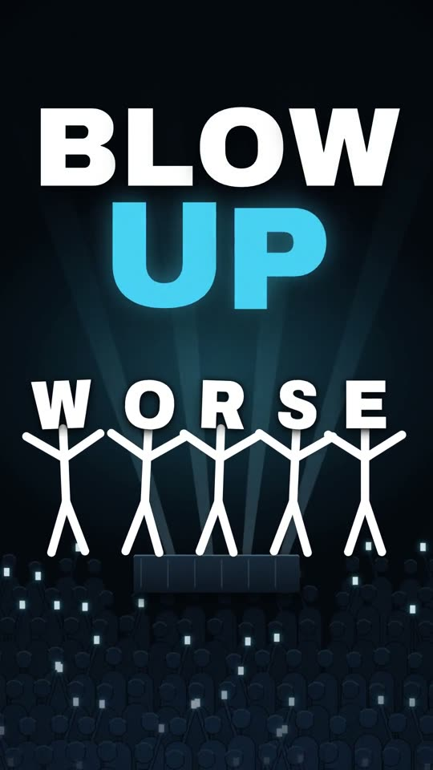
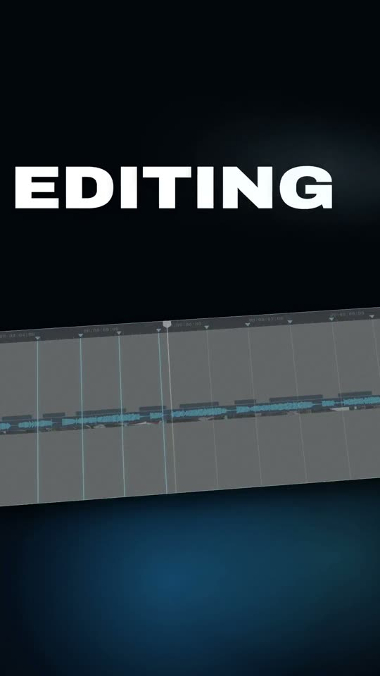
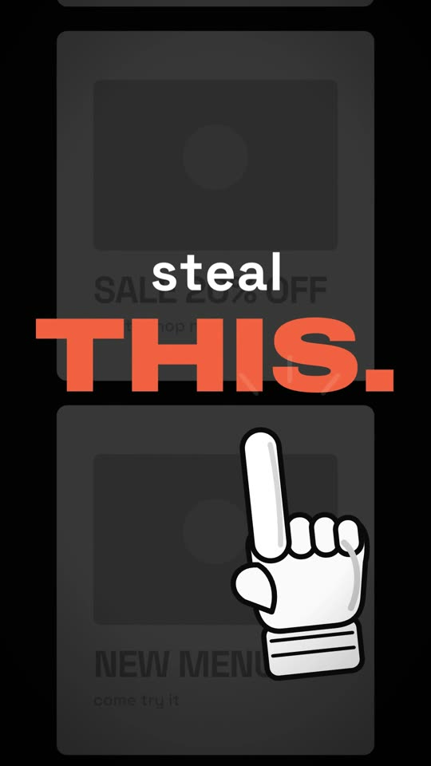
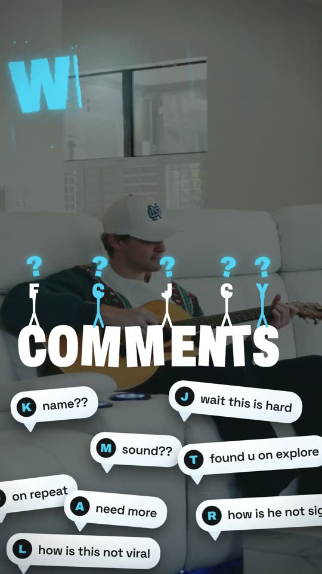
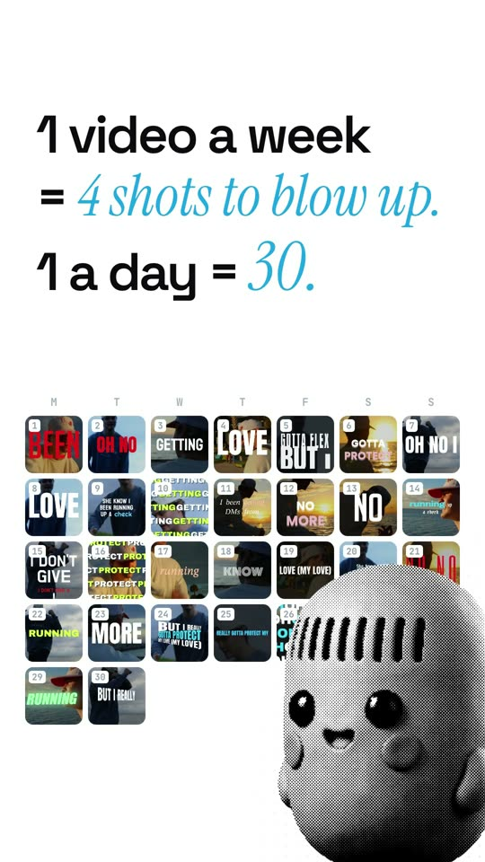

# Motion Ad Kit

A Claude Code skill that makes motion-graphic Instagram reels for your business.
The same rules loya used to make [LYRC](https://lyrc.studio)'s ads, rewritten for any business.

Tap a video to watch it. These are the bar: every ad the kit makes is held to them.

## Install (2 minutes)
1. You need **Claude Code** (the Claude desktop app's Code tab, or `claude` in a terminal) on a paid Claude plan. Tested on a Mac.
2. Open Claude Code and say:

   > Install the motion-ad skill from https://github.com/andrewloya/motion-ad-kit, then set it up for my business.

   Claude copies the `motion-ad` folder to `~/.claude/skills/motion-ad`, installs what's missing (ffmpeg, uv, HyperFrames), and asks you a few questions about your business: what you sell, who buys, your colors, your music, your footage.

   (Or download it yourself: green **Code** button → **Download ZIP**, unzip, and tell Claude where the `motion-ad` folder is.)
3. Then ask for an ad:

   > Make a motion ad for &lt;the thing you want to sell&gt;. Music-driven, using &lt;your track&gt;.

   Or paste the link to an ad you love (Instagram, TikTok, YouTube) and say: **make this for my company.**

Nothing in this kit posts anything or spends money on its own. Music-driven ads need no API keys. A narrator voice uses your own ElevenLabs key (optional).

## For Claude
Copy the `motion-ad` folder to `~/.claude/skills/motion-ad` (keep everything inside it), then follow `~/.claude/skills/motion-ad/SETUP.md`.

## What's inside
| | |
|---|---|
| `motion-ad/SKILL.md` | the rules and the build order (start here) |
| `motion-ad/SETUP.md` | first run: tools, optional keys, the questions about your business |
| `motion-ad/BRAND.md`, `brand.json` | your business, colors, fonts, call to action, voice, folders (filled in on the first run) |
| `motion-ad/REFERENCE.md` | send an ad you love and say "make this for my company" |
| `motion-ad/HOOKS.md` | how the first 3 seconds get written (6 ideas, build the best one) |
| `motion-ad/STYLE.md` | the look: type, color, motion, spacing, sound |
| `motion-ad/STRUCTURE.md` | how a reel is built on the music |
| `motion-ad/NARRATION.md` | the voice-over mode |
| `motion-ad/PIPELINE.md` | the commands |
| `motion-ad/GOTCHAS.md` | every bug the ads hit, and the fix |
| `motion-ad/scripts/` | the scaffold, music mapping, mixing, voice, 10 automatic checks and a critic |
| `motion-ad/examples/` | how the example ads were built: contact sheets, full compositions, notes |
| `example-videos/` | the example ads themselves |

## Credits
Made by loya and Claude, from building LYRC's ads.
Renders with [HyperFrames](https://github.com/heygen-com/hyperframes). Animation by GSAP (free, [GSAP Standard License](https://gsap.com/standard-license)). Fonts under the SIL Open Font License (`motion-ad/fonts/LICENSES.txt`). The example videos are LYRC ads, here to learn from, not to reuse.
